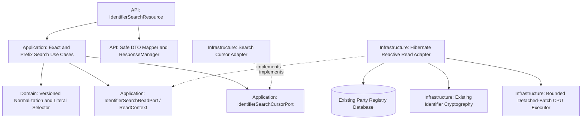
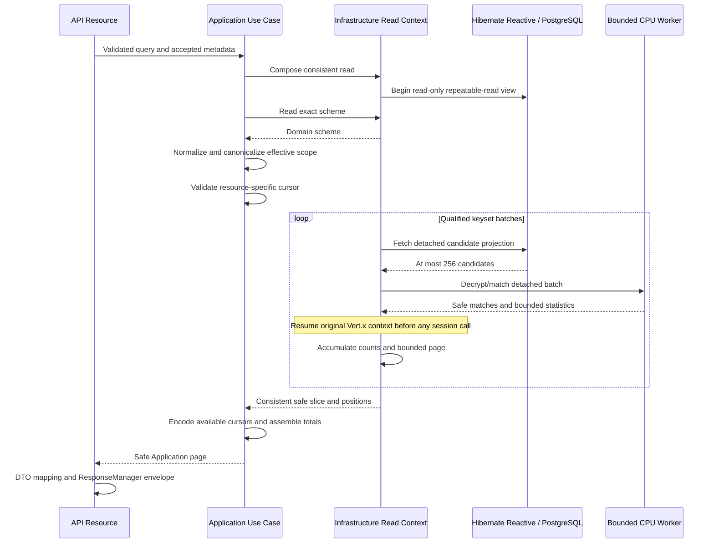

## Context

The current checkout uses Java 25, Gradle Wrapper `9.7.0`, Quarkus BOM `3.40.1`, Mutiny, and Hibernate Reactive with Panache. Native container builds select the configured Mandrel JDK 25 image. These configured versions are the implementation baseline; this search change does not own their upgrade. Application workflows are framework-independent objects composed by Infrastructure CDI producers. Existing architecture tests enforce inward dependencies, a synchronous framework-free Domain, and explicit shared response envelopes at business JSON resources.

The approved [OpenAPI source](../../../docs/contracts/party-registry.openapi.yaml) declares both searches, but neither has a REST resource or search workflow. Existing storage already provides:

- `party_identifiers.encrypted_value`, an authenticated AES-256-GCM envelope with retained encryption-key and normalization versions;
- a tenant-derived HMAC-SHA-256 `normalized_value_hash`, indexed by tenant, scheme, hash, and status;
- a stored safe mask and independently versioned identifier history;
- tenant-qualified Party ownership, lifecycle states, and common summary fields;
- independent pagination signing keys and established read-only repeatable-read transactions with finite query budgets.

`JcaIdentifierProtectionAdapter` owns the existing cryptographic format. Its lookup-hash method is private, and its package-private decrypt helper currently requires a registration request as context. Search needs narrower Infrastructure capabilities without inventing registration input or copying cryptography.

`PartyNamePageAccumulator` demonstrates bounded full-scan counting and bidirectional selection. `HmacPartyIdentifierCursorAdapter` demonstrates authenticated identifier positions. Their resource-specific contracts are not suitable for direct reuse as search APIs; reuse the proven patterns and key material while keeping search responsibilities explicit.

### Central architecture alignment

The central [service definition](file:///home/alex/Documents/Development/architecture/alex-astudillo-architecture/catalog/system/microservices.c4#L9) identifies the same reactive stack and confidentiality boundary. The [exact-lookup sequence](file:///home/alex/Documents/Development/architecture/alex-astudillo-architecture/architectures/party-registry/party-registry-sequences.c4#L177) confirms tenant-derived HMAC lookup but currently describes active-only scheme/identifier selection.

The generated EARS specifications deliberately extend discovery to explicitly selectable history. Retain the central system relationships and protection mechanism; replace only that active-only search assumption with the specified historical eligibility. Record the sequence refinement for the architecture repository's follow-up. This repo-local change introduces no new external system relationship.

## Requirements Traceability

`E` refers to [exact-search requirements](specs/party-exact-identifier-search/spec.md); `P` refers to [prefix-search requirements](specs/party-prefix-identifier-search/spec.md). Requirement names below match those artifacts.

| Requirement | Design Element |
|---|---|
| E: Published exact identifier search contract | Explicit resource signature, OpenAPI completion, shared contract assertions |
| E: Trusted exact-search context and correlation | Existing RequestContextFilter and RequestMetadataContext |
| E: Strict exact-search request validation | Closed exact request decoder, raw UTF-16 limits, API input support |
| E: Exact scheme-qualified normalized matching | Domain normalizer resolution, exact HMAC lookup, same-view scheme resolution |
| E: Explicit historical status selection | Immutable effective status sets and conjunctive bound predicates |
| E: Tenant-qualified result cardinality and ordering | Qualified identifier/Party join, exact count and full projection |
| E: Safe exact-search envelope and complete metadata | Safe hit model, API mapper, ResponseManager, existing pagination writers |
| E: Safe exact-search failures and finite execution | Neutral failures, existing API translation/global handler, read deadlines |
| P: Published identifier-prefix search contract | Prefix resource, write-only prefix documentation, HTTP/schema assertions |
| P: Trusted prefix-search context and correlation | Existing context boundary; no request-scoped state on CPU workers |
| P: Strict prefix-search request validation | Closed prefix decoder and context/body/scheme/cursor precedence |
| P: Literal scheme-normalized prefix matching | Domain selector policy, authenticated internal decryption, literal comparison |
| P: Explicit historical prefix-search filters | Effective status sets applied before candidate decryption |
| P: Tenant-qualified hit cardinality and deterministic ordering | Qualified joined candidate projection and strict timestamp/UUID keysets |
| P: Strict bounded prefix page size | Exact integer-token validation and page-bounded accumulator |
| P: Scoped stable prefix continuation | Search-specific authenticated cursor and canonical effective scope |
| P: Safe prefix response and exact collection metadata | Full qualified traversal, bounded safe page, one read snapshot |
| P: Safe prefix failures and finite execution | Bounded CPU dispatch, cancellation cleanup, typed 503 and sanitized 500 |

The proposal's architecture, Java, SonarQube, and native constraints are addressed by the Architecture and Testing Strategy sections rather than added as new business behavior.

## Goals / Non-Goals

**Goals:**

- Deliver both existing operations using strict architectural boundaries and the published response/error module.
- Reuse the existing exact-lookup index without decrypting exact-search records.
- Make existing encrypted history immediately searchable by prefix without a plaintext column, value rewrite, or registration backfill.
- Produce exact metadata and correct live forward/backward navigation within finite resource budgets.
- Make JVM, native, architecture, IDE, and SonarQube acceptance independently verifiable.

**Non-Goals:**

- New routes, fuzzy/substring/wildcard matching, new admission algorithms, or changes to write/lifecycle behavior.
- A new response library, exception-handling stack, authentication profile, search engine, or SonarQube server.
- A production latency SLA, an immutable dataset across HTTP requests, or automatic cursor expiry.
- A general repository/pagination framework or restructuring unrelated application features.

## Architecture



Domain owns supported normalization and literal matching semantics. It imports no Mutiny, Quarkus, HTTP, persistence, cryptography, or response types. Application owns scheme resolution, effective filters, cursor scope, sequencing, and result assembly; it may use Mutiny under the selected reactive profile but has no framework annotations or database types.

API owns strict wire binding, trusted-context access, DTO mapping, pagination-capacity conversion, and HTTP failure translation. Infrastructure implements consistent reads, SQL/HQL, cryptography, cursor authentication, CPU scheduling, and composition. Resource methods call use cases, never repository ports or cryptographic helpers.

Use one read-context port to express that scheme resolution and result evaluation belong to a consistent view. Infrastructure opens and closes its session; Application neither sees nor retains it. No Application class locates CDI beans or imports an Infrastructure implementation.

## Components and Responsibilities

### API delivery

**Responsibility:** expose the two declared operations and translate their wire contracts.

**Collaborators:** search use cases, RequestMetadataContext, existing API request support, PartyApiErrorTranslator, and CDI-managed ResponseManager.

- `IdentifierSearchResource` at `/v1/parties/search`, with exact and prefix POST methods.
- Separate exact/prefix request models and closed token-aware deserializers; a focused shared reader only for genuinely shared string/status-array rules.
- `IdentifierSearchJsonReaderInterceptor` only for search-specific binding-failure translation, mirroring existing narrow reader interceptors. It is not a global exception mapper or success filter.
- `IdentifierSearchResponse` and nested `IdentifierSearchIdentifierResponse`, containing only the ten declared item fields.
- `IdentifierSearchApiMapper`, mapping Application hits before wrapping and creating checked PaginationMetadata.

### Domain search policy

**Responsibility:** resolve the already registered versioned normalizer and express complete equality/literal prefix semantics independently of admission rules.

**Collaborators:** IdentifierRuleCatalog and IdentifierNormalizer.

Add a normalizer-only resolution capability to the existing catalog; do not call `evaluate`, which also applies complete-value validation. A focused selector policy constructs the transient canonical value and carries the supported normalization identity. It can normalize decrypted historical text using the same selected rule without invoking validators, scheme length bounds, expiration checks, or registration eligibility.

Keep registration behavior and its existing catalog evaluation unchanged. Unsupported selected normalization becomes a known search failure; corrupt/unusable stored material remains a technical failure. Sensitive selector representations have redacted diagnostics.

### Application orchestration

**Responsibility:** coordinate trusted, normalized, historically filtered searches and return transport-neutral safe results.

**Collaborators:** Domain policy, IdentifierSearchReadPort, IdentifierSearchCursorPort, existing OperationObservationPort.

- `SearchPartiesByIdentifierUseCase`: resolve scheme, normalize, evaluate exact matches, assemble complete-result metadata.
- `SearchPartiesByIdentifierPrefixUseCase`: resolve scheme, normalize, authenticate continuation, request a prefix slice, encode available navigation, and compute page totals.
- Dedicated exact/prefix queries retain raw input only for this operation and redact values/cursors in `toString`.
- `IdentifierSearchFilters` contains immutable nonnull enum sets. Omission expands to the complete declared set; empty stays empty. Order/duplicates disappear in the effective representation.
- `IdentifierSearchScope` contains tenant, scheme identity/exact code, normalizer identity/version, normalized prefix, effective state sets, and effective limit. It contains no HTTP types, user/process scope binding, session, or cryptographic key.
- `IdentifierSearchHit` contains safe common Party and matching-identifier fields. Its position retains identifier ID and full-precision creation instant internally.
- `IdentifierSearchPage` contains safe items, nullable opaque cursors, and exact `long` totals. Positions and sensitive criteria never enter its HTTP DTO mapping.

### Infrastructure read implementation

**Responsibility:** provide one read-only consistent snapshot with qualified projections and bounded candidate traversal.

**Collaborators:** existing reactive SessionFactory, PartyQueryTimeouts, scheme persistence mapping, identifier crypto support, bounded CPU dispatcher, and persistence observation/failure translation.

`HibernateReactiveIdentifierSearchReadAdapter` implements the read port and supplies a per-subscription read context. Focused query/projection and prefix-accumulator helpers avoid a large adapter containing parsing, cryptography, business admission, and pagination logic together.

Use joined scalar projections, not managed Party/identifier aggregates or per-hit enrichment queries. Query operations remain sequential on the owning Vert.x context. Exact projections contain no ciphertext; prefix candidate projections contain only the safe hit fields, ordering position, and private protected-value/AAD metadata required for matching. Map scalar tuples through a focused checked Infrastructure mapper; if constructor projections require reflection under the resolved BOM, register only those actual Infrastructure projection types for native execution.

### Cryptography and CPU dispatch

**Responsibility:** reuse persisted protection formats and keep potentially expensive batch computation off the event loop.

**Collaborators:** JcaIdentifierProtectionAdapter, CryptographicKeyMaterial, a lifecycle-owned bounded CPU executor, and the captured originating Vert.x context.

Factor existing Infrastructure crypto internals only enough to expose tenant lookup derivation and authenticated matching with identity-only context. Introduce a narrow context containing tenant/Party/identifier/scheme IDs and stored protection versions; do not fabricate plaintext registration requests to call the current decrypt helper. Preserve the existing HMAC derivation, ciphertext envelope, AAD layout, masks, and registration path through compatibility tests.

Only detached immutable candidate batches enter CPU work. The worker receives no session, CDI request-scoped bean, persistence entity, HTTP object, or completion logger. It decrypts, applies the Domain-defined selector, and returns safe matching hits plus bounded scan statistics. Plaintext never becomes an Application result or cursor field.

### Cursor and composition

**Responsibility:** authenticate this resource's continuation independently of existing list tokens.

**Collaborators:** IdentifierSearchCursorPort and existing PartyCursorKeyMaterial.

`HmacIdentifierSearchCursorAdapter` uses the existing signing ring with search-specific authentication and scope contexts. Add a focused `IdentifierSearchUseCaseProducer` in Infrastructure configuration instead of expanding the already large general ApplicationUseCaseProducer.

## Interfaces and Contracts

### REST boundary

Both methods return:

```java
Uni<RestResponse<ApiResponse<List<IdentifierSearchResponse>>>>
```

Construct successes with `responseManager.paginatedHttp(mappedData, checkedPagination)`. Do not expose Domain objects, Application results, persistence entities, bare DTOs, raw Response, or manually constructed envelopes. The existing PartyPaginationObjectMapperCustomizer already preserves explicit null cursors on envelopes with complete nonnull counts; retain that mechanism and verify both searches use it correctly in native execution.

Exact search supplies null next/previous cursors, `totalElements == numberOfElements == data.size()`, and totalPages 0 or 1. Prefix search supplies live neighbor cursors, exact totals before continuation, and ceiling division using `long` arithmetic without overflowing `total + limit - 1`. Convert with `Math.toIntExact` at the API boundary; detect unsupported totals before loading an oversized exact collection where possible.

### Strict binding and OpenAPI completion

- Exact permits only scheme code, value, and two state arrays. Prefix adds prefix instead of value, nullable cursor, and integer limit. No query parameters are accepted.
- Reject duplicate/unknown properties, trailing content, incompatible scalar tokens, null state arrays/items, and incorrect enum casing. Missing/null body maps to request-body-required; other invalid search inputs map to bad-request.
- Validate raw string lengths with UTF-16 units as specified: scheme 64, exact value 256, prefix 64. Do not normalize before raw validation or impose a second limit after case expansion.
- Preserve omitted versus explicitly null limit. Accept only an integer JSON token in 1..200; inspect an oversized numeric token without narrowing/wrapping it first. Null cursor and omission both mean first page; blank cursor is invalid.
- Add closed-object declarations, writeOnly prefix, explicit success Process-Id headers, precise historical/filter/order/metadata descriptions, and operation-specific examples and 400/401/404/405/415/422/500/503 documentation.
- Tighten affected success schemas to status 200, closed safe fields, nonnull count ranges, and the required nullable cursor properties. No pagination inputs are added to exact search.
- OpenAPI string maxLength normally counts Unicode code points. Keep its upper bounds and explicitly document the stricter raw UTF-16 rule with a search-schema `x-string-length-unit: utf16-code-units` extension. Test-only search assertions enforce the extension's limit in addition to ordinary schema validation; never silently claim a code-point-only validator proves the raw-unit rule.

Binding errors must contain no rejected JSON or request value in their public response or logged parser diagnostic. Register actual request/response/deserializer types for native reflection at the API boundary, following existing records and codecs.

### Read and cursor ports

The proposed Application contracts are conceptually:

```text
IdentifierSearchReadPort.withRead(work: IdentifierSearchReadContext -> Uni<T>): Uni<T>
ReadContext.findSchemeByCode(exactCode): Uni<Optional<IdentifierScheme>>
ReadContext.findExact(normalizedSelector, effectiveFilters): Uni<ExactSearchSlice>
ReadContext.findPrefix(scope, optionalBoundary): Uni<PrefixSearchSlice>
IdentifierSearchCursorPort.decode(scope, token): SearchBoundary
IdentifierSearchCursorPort.encode(scope, boundary): String
```

Read context methods do not expose SQL, sessions, ORM entities, ciphertext, or hashes. The callback expresses an operation-scoped consistent read, not a general-purpose transaction manager. Prevent context use after callback completion. Existing identifier position/direction value types may be reused when they express the identical ordering contract; existing Party-qualified list criteria and ports remain separate.

Application handles scheme absence and supported normalization before cursor authentication. Empty status sets still undergo scheme/normalizer and, for supplied prefix tokens, cursor validation; only then may the read produce an empty collection without candidate queries.

## Data Model

### Existing data and qualified predicates

Use the existing parties, identifier_schemes, and party_identifiers tables. The conceptual join is:

```sql
FROM party_identifiers i
JOIN parties p ON p.tenant_id = i.tenant_id AND p.id = i.party_id
JOIN identifier_schemes s ON s.id = i.identifier_scheme_id
WHERE i.tenant_id = :tenant
  AND p.tenant_id = :tenant
  AND i.identifier_scheme_id = :scheme
  AND i.status IN (:identifierStatuses)
  AND p.record_status IN (:partyStatuses)
```

The actual implementation uses typed reactive HQL/projections and bound parameters with the existing entity field names. No submitted value becomes query text. Never generate an empty IN clause; empty effective sets short-circuit after preceding validation. No implicit scheme, Party-state, expiration-date, primary, or subtype eligibility predicate is added.

### Exact lookup

Derive the same tenant-specific HMAC as registration and add equality on normalized_value_hash. Query count and all safe hits sequentially in the same snapshot, ordered by `i.created_at DESC, i.id DESC`. Do not use firstResult, DISTINCT Party, a page limit, or decryption. A count above the supported response range fails before collection materialization; a zero count returns the explicit empty result.

Selectors unrepresentable by the storage encoding cannot match accepted stored data. Preserve exactness instead of replacement-character conversion: an unrepresentable scheme selector is absent, and an unrepresentable normalized value matches no rows. This follows the unknown-scheme/nonmatching-value contract rather than misclassifying invalid encoding as dependency unavailability. Stored decoding corruption still fails as server-error.

### Prefix candidates and ordering index

There is no prefix-searchable plaintext or prefix token in existing storage. A full-value HMAC cannot answer startsWith, and randomized ciphertext/masked values cannot be used as a substitute.

Add the next available immutable Flyway migration, expected `V9__add_identifier_search_order_index.sql`, containing only:

```sql
CREATE INDEX ix_party_identifiers_scheme_created_id
    ON party_identifiers (tenant_id, identifier_scheme_id, created_at DESC, id DESC);
```

Verify V9 is still free at implementation time. Keep V1-V8 immutable. This index supports tenant/scheme ordered candidate traversal; the existing tenant/scheme/hash/status index remains the exact-lookup path. Do not index every possible state combination or persist plaintext/search prefixes. No data or cryptographic backfill is needed.

Traverse qualified candidates with strict `(created_at, id)` keysets in batches of at most 256. The internal scan boundary advances using the last candidate, even if no candidate in that batch matches. Do not filter the traversal itself by the requested HTTP cursor: exact totals require examining every qualified candidate before continuation.

### Bounded prefix accumulation

For each matching identifier, increment a checked long total, retain global first/last matching positions, and update a safe deque of at most effective limit entries:

- First page: retain the first matching limit entries in descending traversal.
- NEXT boundary: retain the first limit entries strictly below the requested tuple.
- PREVIOUS boundary: retain the last limit entries strictly above the requested tuple, evicting the oldest retained entry as necessary. This selects the nearest preceding page while output remains descending.
- Produce neighbor availability by comparing global match extrema to page endpoints, or to the authenticated requested tuple when its page is empty.
- Zero global matches returns zero counts and null cursors. Empty continuation with matches elsewhere retains totals and only actual relative navigation.

Retained prefix state is O(batch size + page size), not O(tenant size). Work is O(qualified candidates) per page because totals are exact. The ordering index bounds batch traversal cost but does not turn encrypted prefix counting into an index-only match query.

## Interaction Flows

### Exact search

1. Existing filter accepts context; API performs strict body/query validation.
2. Use case opens a composed read through the port. Infrastructure establishes READ ONLY, REPEATABLE READ and transaction-local deadlines before querying.
3. Read the scheme by exact code in that view. Application applies the supported Domain normalizer, without registration eligibility/validator calls.
4. Infrastructure derives the persisted tenant HMAC and executes sequential count/full-safe-projection queries with both state filters.
5. Application returns safe hits and complete metadata after the read finishes. API maps DTOs, checks count capacity, and calls ResponseManager.
6. Known failures translate at the API boundary; the shared module creates final errors. The context filter echoes the accepted process and completes attribution/cleanup.

### Prefix search and CPU/session boundary



Perform CPU work through a local Uni with runSubscriptionOn on the dedicated bounded executor, then dispatch items and failures back to the captured originating Vert.x context using an emitOn executor backed by that context's runOnContext. Only after that return may the pipeline query again or complete the read callback. Do not offload the entire Hibernate pipeline or execute concurrent operations through its session.

Scheme resolution, cursor validation, every candidate batch, counts, and page selection share one snapshot. Encoding final cursors needs only safe positions and the effective scope, not an open session. Every subscription creates its own context and accumulator.

## Error Handling

| Condition | Expected handling |
|---|---|
| Trusted-context failure | Existing field-specific HTTP 400 code and accepted-only process echo |
| Absent/null body | 400 request-body-required |
| Malformed, ambiguous, oversized, wrong-type, or unsupported input | 400 bad-request |
| Unknown exact scheme code | Neutral UnknownIdentifierScheme -> 422 unknown-identifier-scheme |
| Known unsupported normalization | Neutral IdentifierValidationFailure -> 422 identifier-validation-failure |
| Invalid/tampered/cross-scope cursor | Existing neutral invalid-identifier-cursor category -> 400 bad-request |
| No matches or empty effective filter | 200 successful empty collection after preceding validation |
| Conditional authentication failure | Existing 401 unauthorized contract |
| Unknown route / unsupported method / media | Existing 404 not-found / 405 method-not-allowed / 415 unsupported-media-type |
| Classified connection/statement/traversal failure or exhausted CPU admission | Neutral DependencyUnavailable -> 503 dependency-unavailable |
| Required ciphertext/AAD/key-version corruption, unsupported stored normalization version, count overflow, or programming failure | Sanitized 500 server-error |
| Client cancellation | Stop owned work and cleanup; no fabricated HTTP success or retry |

Reuse PartyApiErrorTranslator and the published `api-response-quarkus-errors` global implementation. Existing neutral categories already cover scheme, validation, cursor, and dependency failures; do not introduce duplicate HTTP-aware Application exceptions or a local global mapper.

Use the existing typed identifier-store unavailability classifier for search SQL/timeouts. Preserve business failures and cancellation rather than treating every exception as an outage. Authentication-tag failure or missing retained key for required stored ciphertext is not a client-prefix validation error and must not silently skip a candidate.

Sanitize search binding and crypto failures at their owning boundaries with fixed diagnostic messages. Do not retain/log sensitive provider or parser messages in an exception chain that the shared unexpected-error logger would print. Unexpected failures remain internally observable with accepted request attribution and safe stack locations, but no value-bearing diagnostics.

## Security

- Tenant-Id is trusted routing/ownership context, not authentication. Preserve existing deployment authentication behavior and require both identifier and Party ownership in every projection.
- Exact lookup reuses the existing tenant-derived index HMAC byte format and secret. No new index key, hash algorithm, registration encryption, or stored mask is introduced.
- Prefix matching authenticates AES-GCM using actual tenant/Party/identifier/scheme IDs and stored normalization/encryption versions. Retain required historical encryption keys; never use the current key/version as an implicit replacement.
- Decrypted text remains within Infrastructure's detached-batch operation and Domain policy invocation. Zero mutable plaintext/key byte arrays in finally blocks; keep unavoidable immutable Strings short-lived and do not claim they can be zeroed. Return stored masks, not freshly remasked plaintext.
- All sensitive request, query, scope, and private candidate representations override diagnostic output. No auto-generated record toString may expose raw/normalized values, tokens, ciphertext, or hashes. Do not serialize query/scope objects or add them to observations.
- Reuse existing pagination keys with separate `party-identifier-prefix-search-cursor-v1` and `party-identifier-prefix-search-scope-v1` authentication domains. Include resource, tenant, scheme ID/exact code, normalizer key/version, normalized prefix, canonical state sets, and limit in scope authentication; exclude user/process and cursor spelling.
- Use a keyed scope HMAC, not the existing list adapter's unkeyed SHA-256 scope digest, because a published digest of a low-entropy prefix would permit dictionary testing. Calculate it with the token's signing/verification key and a separate context, so retained older signing keys continue to verify old scopes during rotation.
- Use versioned canonical bounded tokens following the existing 256-character maximum: direction, full-precision timestamp, identifier UUID, limit, and keyed scope digest plus an outer MAC. Verify signature and scope with constant-time comparisons, reject malformed/noncanonical formats before allocation, and never embed selector plaintext.
- Omitted/full state sets and duplicate/reordered arrays canonicalize identically. Empty sets remain distinct. Altered resource, tenant, scheme, normalization, prefix, state set, or limit rejects continuation. A valid boundary need not still exist.

## Resilience

Reuse existing `party-registry.queries.statement-timeout` and `traversal-timeout` settings (defaults 5s and 15s). Track the operation deadline from subscription, including pool/session acquisition, scheme work, CPU queue delay, decryption/matching, and all batches; each SQL statement additionally uses a transaction-local deadline. Bound acquisition before a session is owned, then apply the remaining deadline inside its read scope so rollback/session cleanup completes before failure propagation. Test exhausted-pool acquisition and late allocation cancellation against the resolved BOM rather than assuming an inner transaction timer covers acquisition.

The prefix CPU executor is Infrastructure-owned and configurable with positive bounded capacity: initial defaults of two workers and 32 queued batches, subject to deployment measurement. Use rejecting admission, never CallerRunsPolicy or blocking queue insertion from the event loop. Every request has at most one outstanding batch; no per-row task fan-out, parallel streams, or unbounded executor/concurrency is permitted.

Queue rejection becomes dependency-unavailable through a typed failure. Cancellation removes queued work where supported; an already running batch checks cancellation between records and discards late completion without accessing a closed read context. Resource/session cleanup cannot wait for synchronous worker completion. Executor lifecycle cleanup belongs to Infrastructure shutdown, not request execution.

No automatic query retries, partial pages, capped totals, masking of corrupt candidates, or cache of plaintext search results is introduced. Separate requests observe live data. A healthy request after cancellation/failure must obtain a fresh usable session and correct attribution.

## Observability

Keep RequestContextFilter as the single owner of context validation, completion logging, accepted process echo, and MDC cleanup. Preserve the exact console format:

```text
%d{yyyy-MM-dd HH:mm:ss,SSS} %-5p [%c{3}] (%t) [pid=%X{processId}] [userId=%X{userId}] [tenantId=%X{tenantId}] %s%e%n
```

Add bounded route/span labels `party.search-by-identifier` and `party.search-by-identifier-prefix` to existing observation mechanisms. Preserve asynchronous context propagation; CPU workers do not read/mutate request-scoped metadata or log sensitive work.

Measure duration/outcome, SQL/candidate batches, candidates inspected, matches, maximum retained page/batch size, CPU queue/rejection, timeout, and cancellation. Metric dimensions contain only fixed operation/outcome labels, never tenant/user/process IDs, scheme codes, identifiers, raw/normalized selectors, cursors, or secrets. Partial scan statistics after failure are measurements of work, not success metadata.

## Testing Strategy

### Unit Tests

- Domain normalizer-only search: supported key/version, complete equality versus prefix, exterior whitespace/case, retained punctuation/accents/interior whitespace, uppercase expansion, and no validator/admission calls.
- Application with port doubles: scheme/normalization/cursor precedence, omitted/empty/full/duplicate state-set equivalence, complete exact results, prefix metadata/cursor assembly, and typed failures.
- Pure prefix accumulator: timestamp ties and unsigned UUID ordering, next/previous nearest pages, disappeared boundaries, empty continuation/global-empty cases, exact totals, and retained state bounded by limit over a large candidate fixture.
- Strict API decoding: closed objects, missing/null bodies and fields, repeated properties, all invalid enum/null cases, raw UTF-16 boundaries including supplementary input, integer-token overflow/fractions/exponents, cursor null versus blank, and trailing content.
- Cryptographic compatibility: unchanged registration/hash/AAD format; same-tenant lookup compatibility and cross-tenant separation; authenticated decrypt of retained versions; corrupt envelope/tag/identity/version/key handling; no plaintext diagnostic output.
- Search cursor: altered/cross-resource/cross-scope token, canonical-equivalence scope, previous direction, timestamp precision, retained-key rotation, maximum token bounds, and absence of plaintext/unkeyed sensitive scope material.
- Mapper/count conversion and architecture rules, including collection payload signatures and exclusion of framework/crypto/HTTP types from inner layers.

Tests must demonstrate behavior and boundary failures, not mirror helper implementation. Every new/modified type, including test and nested types, receives concise responsibility Javadoc.

### Integration Tests

- Real PostgreSQL with Flyway and reactive Vert.x test context verifies qualified joins, all stored states/Party types, withdrawn schemes, historical duplicates, more than 200 exact matches, and exact-read snapshots.
- Prefix tests use actually protected stored values created through the existing protection mechanism, not mocks that bypass AES/HMAC. Cover literal punctuation, partial official-ID fragments, batch boundaries, Unicode normalization, and timestamp precision/UUID ties.
- Deterministically coordinate an intervening writer between count/batch operations to prove same-response snapshot consistency; subsequent requests must see current state. Do not use timing sleeps to infer ordering.
- Verify no Party/identifier/scheme/nationality/version/audit/replay/event mutation after successful, invalid, cancelled, or failed searches.
- Exercise crypto worker thread identity and return to the identical owning Vert.x context before each Hibernate call, sequential session usage, bounded queue rejection, cancellation, late completion, and subsequent pool reuse. Keep blocked-thread diagnostics enabled.
- Verify the V9 index through migration execution and inspected query plans. Explain index/traversal cost at representative tenant/scheme volumes; measure candidate count, decrypt count, CPU queue, duration, page retention, and timeout outcomes. Prefix totals necessarily scan all filtered candidates; record results rather than claim an untested SLA.

### Contract Tests

Add test-only IdentifierSearchContractAssertions under `src/contractTest/java`, reusing existing Swagger/Jackson validation helpers where their semantics are applicable. Keep search-specific strict token, UTF-16-unit, field-closure, full-count/null-cursor, and status/code checks explicit. Add negative fixtures proving that drift and leaked fields fail the assertions.

For both routes exercise real HTTP success, empty data, context precedence and echo, malformed/null/wrong-type requests, scope rejection, declared 422 outcomes, framework 404/405/415, controlled dependency/timeout 503, and sanitized injected 500 with value-bearing diagnostics. Assert actual status equals body status and errors have only status/code. Authentication cases apply only to a real enabled authentication profile; headers alone must not create one.

Parse approved, packaged, and served OpenAPI and validate examples/references and actual HTTP JSON. A successful parser result or Java compilation is insufficient. Add PackagedIdentifierSearchContractIT under the existing packaged/native source set, excluding unit-test CDI alternatives; cover actual deserializer/reflection, JCA, token rotation, null cursor writers, and pre-existing encrypted data.

### Java, SonarQube, and verification evidence

Maintain a change-local inventory of every modified/new production, unit, shared-contract, and integration Java file and its final saved Git blob. During implementation, reconcile JDTLS Standard-mode diagnostics against the resolved Java 25 Gradle model and compiler results; do not ignore a discrepancy or suppress nullability/type-safety warnings.

Use cohesive small methods, immutable models, exhaustive enum handling where useful, declared nullable boundaries, checked numeric conversions, finite resource ownership, and constructor-based collaborators. Avoid unchecked tuple casts without isolated validated mapping, needless optionals/null fallbacks, duplicated cryptographic code, blanket catches, exception-message assertions, and unused abstractions. Preserve English code/messages/Javadoc and the established logging format.

Run actual SonarQube for IDE analysis on every final saved affected Java file with its dependencies resolved. Record the current analyzer version, active rules/parameters, file revision, analysis completion, issue/hotspot details, fixes, and reanalysis separately from JDTLS. Do not weaken rules, add blanket exclusions/suppressions, accept incomplete-model zero counts, or infer a remote Quality Gate from standalone IDE evidence. The project's prior 5.7.0/571-rule evidence is historical, not proof of the current run.

Required implementation commands:

```shell
./gradlew test
./gradlew build
./gradlew buildNative -Dquarkus.native.container-build=true
./gradlew testNative -Dquarkus.native.container-build=true
openspec validate complete-party-search-endpoints --type change --strict --no-interactive
```

Use the repository's documented Podman/Testcontainers prerequisites when necessary. Record actual command results and native HTTP evidence; JVM success or native metadata preparation does not prove native execution. Inspect both resource signatures, mapping order, and contract assertions before marking implementation complete. This design artifact records planned verification, not completed test/Sonar/native results.

## Decisions

### Decision: Existing HMAC for exact lookup and detached traversal for prefix

**Choice:** use the existing tenant index for exact equality; perform prefix matching over ordered qualified encrypted batches and collect only safe bounded page state.

**Rationale:** preserves existing history and protection formats, satisfies full historical/count semantics, and avoids changing registration or requiring a cryptographic data backfill. The additional ordering index accelerates traversal but does not remove its linear cost.

**Alternatives considered:**

- LIKE on hashes, ciphertext, or masks: does not implement literal identifier-prefix behavior.
- Plaintext normalized column: violates confidentiality and proposal scope.
- Precomputed keyed prefix index: could improve query work but needs a privacy/storage design, durable historical backfill, write-path maintenance, retained-key/version policy, and additional native migration verification. Defer as a separately specified optimization if measurements show the selected path cannot meet deployment needs.
- Approximate totals or stop-after-one-page scan: conflicts with exact metadata requirements.

### Decision: Whole-operation consistent read with detached CPU work

**Choice:** let Application compose its operation through a scoped read port; Infrastructure uses one read-only repeatable-read transaction and returns from a bounded CPU batch to its original context before continuing.

**Rationale:** guarantees scheme/data/count/navigation consistency without framework leakage or unsafe session sharing.

**Alternatives considered:** separate scheme/count/page transactions, parallel use of one session, or offloading the entire Hibernate flow. These weaken snapshot consistency or violate reactive context safety.

### Decision: Distinct read/search policy and keyed sensitive cursor scope

**Choice:** normalize for lookup without admission validation and authenticate normalized prefix scope with a resource-specific keyed HMAC.

**Rationale:** supports partial/checksum-incomplete selectors and historical evidence, while avoiding plaintext or dictionary-testable prefix digests in tokens. Existing registration and list-cursor contracts remain intact.

**Alternatives considered:** reuse registration evaluate/eligibility, deduplicate by Party, or copy the list codec's unkeyed scope hashing. These conflict with read semantics, hit cardinality, or sensitive-selector protection.

## Migration / Rollout / Rollback

1. Confirm the next production migration version, then add the qualified ordering index through Flyway only. Review build time, locking, and storage overhead on a representative database clone; automatic schema generation and manual DDL remain disabled.
2. Retain all existing encryption/index/signing keys and verify required historical encryption versions before enabling prefix traffic. Distribute signing verification keys consistently across replicas before changing current key ID.
3. Deploy the completed OpenAPI, strict codecs, use cases, migration, and packaged/native-tested artifact together. Introduce the routes only with their documented historical behavior; no admission rewrite, plaintext cache, or replay/event data migration is required.
4. Benchmark the actual deployed tenant/scheme volumes and CPU/pool pressure with the finite settings. If prefix exact-count work is too expensive, report dependency-unavailable within the existing deadline and plan an explicitly scoped indexing optimization rather than weakening counts or search eligibility.
5. Rollback retains the additive index and all existing protected/historical data and keys. Restore a compatible executable or temporarily remove search traffic routing; do not edit applied migrations, rewrite values/statuses, or delete history to accommodate an older binary.
6. Coordinate the active-only sequence refinement in the central architecture repository. It is a separate repository concern; this change's implementation edit root remains this service.

## Risks / Trade-offs

| Risk / Trade-off | Mitigation |
|---|---|
| Prefix exact totals require O(qualified candidates) work on every page | Ordered index, database-side state/tenant/scheme filters, 256-row batches, bounded CPU work, finite deadlines, representative measurements |
| Exact API requires the entire matching history in one response | Indexed qualified count first, checked capacity, finite work budget; document O(match count) response memory and never silently truncate |
| CPU offload accidentally reuses a session on the wrong context | Detached data only, explicit original-context emission, sequential session operations, thread/context assertions and cancellation tests |
| Required old encryption key or stored ciphertext is unusable | Retain key versions, authenticate actual AAD, fail sanitized without skipping candidates or inventing a match |
| Prefix scope could leak through low-entropy digest or diagnostics | Keyed resource-specific scope HMAC, redacted representations, no sensitive exception chains or telemetry dimensions |
| Schema code-point limits do not prove raw UTF-16 limits | Explicit length-unit extension/descriptions and separate positive/negative HTTP assertions |
| Longer snapshot transactions hold a connection and MVCC view | One finite operation budget, sequential bounded batches, measured concurrency, queue rejection and cleanup/pool-reuse tests |
| New index introduces deployment cost | Additive Flyway migration, production-sized clone review, retain harmless index on rollback |
| Source, central sequence, and served contract drift | Named requirement traceability, schema/HTTP equality checks, explicit narrow historical-sequence follow-up |
| Compilation or incomplete IDE output gives false quality confidence | Per-file resolved JDTLS/Sonar evidence, full required JVM/native commands, explicit public-boundary inspection |

### References

- Existing local boundaries: [identifier operations guide](../../../docs/operations/party-identifier-contract.md), [root operations guide](../../../docs/operations/root-party-contract.md), and architecture tests.
- [Hibernate Reactive sessions and Vert.x contexts](https://hibernate.org/reactive/documentation/4.2/reference/html_single/#_sessions_and_vert_x_contexts) and [executing code on the originating context](https://hibernate.org/reactive/documentation/4.2/reference/html_single/#_executing_code_in_a_vert_x_context).
- [Mutiny emitOn versus runSubscriptionOn](https://smallrye.io/smallrye-mutiny/latest/guides/emit-on-vs-run-subscription-on/). Confirm exact APIs against the service's resolved Quarkus BOM during implementation; the cited context model is not a declaration of this project's Hibernate Reactive artifact version.
