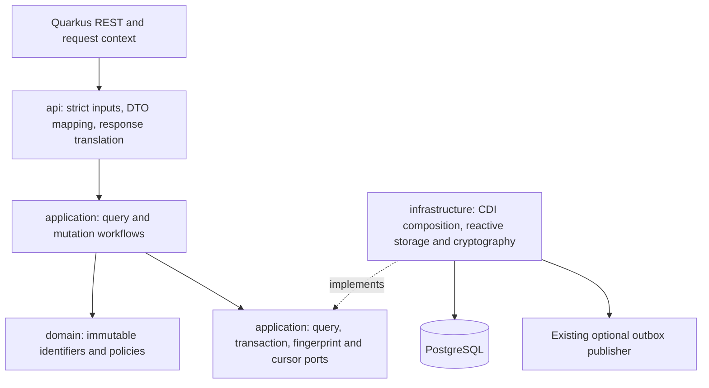

## Context

The service uses Java 25 and the Quarkus 3.33.3.1 BOM, Mutiny, Hibernate Reactive, a PostgreSQL reactive datasource, and Flyway. JDBC is restricted to migration. API resources use the published `api-response-quarkus-errors` dependency, `ResponseManager`, and service-owned error translation. The static contract in `docs/contracts/party-registry.openapi.yaml` is copied to `META-INF/openapi.yaml`; runtime annotation scanning is disabled.

The relevant existing implementation is:

- `PartyIdentifierResource` exposes additional registration only. Its resource already maps `PartyIdentifierResult` to `PartyIdentifierResponse` before producing a `201` envelope. Its local binding mapper is resource-scoped, not a global business mapper.
- `RegisterPartyIdentifierUseCase` resolves the Party type, prepares a protected identifier, and delegates atomic identifier/outbox insertion. Although it validates and carries an idempotency key, `HibernateReactivePartyIdentifierRegistrationAdapter` currently records no durable completion. Repeated calls therefore do not satisfy the newly approved historical replay requirement.
- `PartyIdentifier` is an immutable independent aggregate with protected value, metadata, primary/state flags, verification evidence, version, and audit. It validates construction but has no correction or lifecycle operations. `PartyIdentifierEntity` has an independent `@Version`.
- `PartyIdentifierReadPort.findCurrentByParty` and its scalar adapter deliberately serve the complete current-identifier projection on natural-person detail, ordered ascending. That contract must remain separate from the new historical, descending, paginated collection.
- V1 already provides active-value uniqueness and one VERIFIED primary per tenant/Party/scheme. V1–V7 are the current immutable migration history. Existing root and catalog workflows demonstrate application-controlled transaction-context ports, serialized replay, guarded writes, and optional outbox intent.

The central LikeC4 project is `default`. The service definition at [catalog/system/microservices.c4:9](/home/alex/Documents/Development/architecture/alex-astudillo-architecture/catalog/system/microservices.c4#L9) and identifier sequence at [architectures/party-registry/party-registry-sequences.c4:136](/home/alex/Documents/Development/architecture/alex-astudillo-architecture/architectures/party-registry/party-registry-sequences.c4#L136) establish separate Party/identifier aggregates, reactive persistence, expected-version checks, safe results, and optional events. The sequence describes expiration at a broader architectural level; the approved delta specifications narrowly exclude an expire endpoint and scheduled expiration from this change. It does not require a new external verification service.

This design implements the decisions confirmed during specification: operator verification, terminal rejected/revoked/expired states, correction of pending/verified metadata, provisional creation flags, primary scope per tenant/Party/scheme, durable keyed replay, and retained optional withdrawal reasons. Component names below describe intended responsibilities, not already implemented classes.

## Requirements Traceability

Q, M, and L denote the three delta specification paths under `specs/`; requirement titles are exact.

| Requirement | Design element |
|---|---|
| Q: Complete published party-identifiers contract | Static OpenAPI completion, eight resource methods, packaged contract equality |
| Q: Trusted context and process correlation | Existing request filter/context, committed disposition recording, concurrent HTTP tests |
| Q: Tenant and Party ownership concealment | Application owner check, qualified queries, mutation-context tenant binding |
| Q: Strict read selectors and filters | API-only raw parameter parser and identifier/version support |
| Q: Complete historical listing and masked detail | New scalar query adapter; unchanged current-identifier port |
| Q: Deterministic scoped cursor navigation | Resource-specific cursor adapter and PostgreSQL keyset reads |
| Q: Exact collection metadata and empty outcomes | Consistent read transaction, long counts, checked pagination mapping |
| Q: Safe shared envelopes and failure behavior | Explicit API DTO envelopes, published global errors, scoped binding translation |
| M: Maintenance follows the common identifier boundary | Per-operation API syntax order and application business precedence |
| M: Strict additional registration input | Strict creation decoder and existing field-specific validation |
| M: Eligible independent registration | Existing preparation policies inside the replay-first creation workflow |
| M: Active-value uniqueness and release | Existing partial unique index, narrow conflict classification, no expiration rewrite |
| M: Durable additional registration replay | Identifier fingerprint port, dedicated completion table and safe snapshot codec |
| M: Strict partial metadata correction | `FieldUpdate` request/command mapping and synchronous aggregate correction |
| M: Metadata correction eligibility and audit | Domain state/date rules, one operation instant, guarded metadata writes |
| M: Identifier-version preconditions and exhaustion | Identifier-specific version parsing, Domain increment guard, conditional persistence |
| M: Strict primary-selection input and eligibility | Strict optional body decoding and Domain primary eligibility |
| M: Scoped atomic primary ownership | Scope lock, Domain two-aggregate plan, demotion before promotion |
| M: Maintenance has one durable observable outcome | One reactive transaction for changes/completion/outbox, rollback tests |
| L: Lifecycle requests follow the common boundary | Bodyless verification guard, reason decoder, exact syntax/failure precedence |
| L: Explicit identifier transition matrix | Synchronous Domain transition methods and full matrix tests |
| L: Operator-confirmed verification and validity | Accepted actor/time passed to Domain; no external/decryption call |
| L: Verification respects provisional primary ownership | Scope serialization and Domain primary-conflict decision |
| L: Rejection and revocation retain safe history | Aggregate withdrawal, independent durable reason audit, retained verification |
| L: Durable action key scope and request equivalence | Versioned operation namespaces and keyed effective-request fingerprint |
| L: Historical action replay survives changes and restart | Replay before live lookup; immutable safe snapshots and restart tests |
| L: Atomic lifecycle concurrency and complete outcomes | Transaction scope, target version arbitration, reason/completion/event atomicity |
| Proposal: TDD, strict architecture, Month fixtures, local quality, native support | Testing and quality preflight, ArchUnit, source inventories, JVM/native verification |

## Goals / Non-Goals

**Goals:**

- Deliver the eight approved operations with requirement/scenario-to-test traceability.
- Keep business decisions in Domain/Application and HTTP/persistence mechanisms at outer boundaries.
- Serialize actual mutation races without treating the Party version as an identifier version.
- Make replay, primary replacement, audit, and enabled outbox intent transactional and restart-safe.
- Read only masked projections on public reads and preserve historical protected data on writes.
- Establish effective local Sonar rules before Java/test implementation, and execute TDD in small verifiable increments.

**Non-Goals:**

- Expiration scheduling, additional actions, external verification, plaintext retrieval, or identifier search.
- Redesign of Party activation, Party registration snapshots, current natural-person projections, or catalog lifecycle.
- A general transaction framework, generic success wrapper, new authentication provider, or remote Sonar scanner setup.

## Architecture



Domain stays synchronous and depends on JDK/domain types only, apart from the project's existing nullability annotations. It must not import Mutiny, CDI, HTTP/envelope types, Jackson, Hibernate, SQL, or logging frameworks. Application may use Mutiny under the explicitly selected reactive profile, but not CDI, Jakarta REST, Jackson, entities/sessions, SQL, or the shared response library. This is the narrow project reactive allowance, not permission to relax strict inward dependency direction.

API depends on use cases and maps their results; resources do not invoke persistence ports or Domain policies directly. Infrastructure implements Application ports and composes use cases through producers as existing features do. ORM entities and transaction/session annotations stay in Infrastructure. Domain/Application failures remain transport-neutral; HTTP codes are selected only in API.

One subscription owns one session/transaction context. Context operations are sequential, bound to tenant and Vert.x context, and invalid after failure or closure. Return every composed Uni; do not manually subscribe, wait, move Hibernate work to arbitrary executors, or combine concurrent work on the same reactive session. Continue the existing SessionFactory transaction style; do not introduce Jakarta `@Transactional` or a second transaction style.

## Components and Responsibilities

### Domain identifier behavior

**Responsibility:** Extend `PartyIdentifier` and `PartyIdentifierVersion` with explicit immutable correction, verification, rejection, revocation, primary selection/demotion, and checked version advancement. Reuse `FieldUpdate` for partial metadata. Add only the neutral violations needed for lifecycle, version exhaustion, validity, and primary conflicts.

**Collaborators:** Existing protected-value/audit types and a small `PartyIdentifierPrimaryPolicy` operating on candidate and optional former-primary aggregates. A primary plan contains at most the target and former primary; it validates common scope and creates both next versions before either is persisted. Storage index exceptions are not the policy implementation.

Aggregate methods receive one Instant and accepted actor from Application. UTC date derivation uses that same instant. Preserve creation audit, protected value bytes, scheme, and verification unless the approved action changes them. Revoke retains verifiedAt/verifiedBy; reject/revoke clear the flag. State legality precedes target exhaustion, which precedes resulting-date validity and primary conflicts. Validate former-primary exhaustion only when actual demotion is needed. No constructor or read method infers EXPIRED from the clock.

### Application workflows

**Responsibility:** Coordinate ownership, replay, expected versions, Domain decisions, and same-transaction persistence. Use separate meaningful workflows for registration, detail, listing, metadata PATCH, lifecycle actions, and primary selection.

**Collaborators:** New `PartyIdentifierQueryPort`, `PartyIdentifierMutationPort`/`PartyIdentifierMutationContext`, `PartyIdentifierFingerprintPort`, `PartyIdentifierCursorPort`, existing clock, observation port, and identifier preparation policies.

Retain `RegisterPartyIdentifierUseCase`, but replace its prepare-before-storage sequence with replay-first transaction orchestration. Add `GetPartyIdentifierUseCase`, `ListPartyIdentifiersUseCase`, `PatchPartyIdentifierUseCase`, `ChangePartyIdentifierLifecycleUseCase`, and `SetPrimaryPartyIdentifierUseCase`. The shared lifecycle workflow uses an explicit VERIFY/REJECT/REVOKE action enum; set-primary is separate because it coordinates two aggregates.

Creation obtains the scheme through the same mutation context and applies existing pure scheme/value preparation to that supplied locked scheme. It must not invoke a repository-opening preparation helper that creates a second session inside the transaction. Keep initial Party-registration preparation behavior intact. Update the existing CDI composition to select the new registration workflow once; retire the old additional-registration port/adapter only after confirming that no production consumer remains, rather than retaining a second non-idempotent route or duplicate adapter binding.

Application commands retain parsed original creation strings for fingerprint equivalence; normalization is only for new protection. Outcomes contain safe `PartyIdentifierResult` and APPLIED/REPLAYED disposition, with creation tracked as a created outcome for telemetry. Domain objects and private reason data never become API results.

### API resource and binding support

**Responsibility:** Expand `PartyIdentifierResource` to eight thin methods; own strict request models, raw query/header/path parsing, response mapping, and known-failure translation.

**Collaborators:** Existing `RequestMetadataContext`, request filter, `PartyIdentifierApiMapper`, `ApiRequestSupport`, `PartyApiErrorTranslator`, and CDI `ResponseManager`. Add identifier-specific request support instead of converting identifier versions through `PartyVersion`.

Use per-model strict streaming deserializers alongside their request models, following the existing `IdentifierSchemePatchRequest` pattern. Detect duplicate/unknown properties, type coercions, trailing tokens, and invalid calendar dates. PATCH maps omitted/present-null separately; reason and replacement bodies map absent/empty defaults explicitly. An optional body arriving as literal null must remain distinguishable from zero incoming bytes.

Use a narrow API pre-binding guard on the verify route to reject any nonzero body bytes. It is unrelated to the one context filter and must not perform context validation, mutate MDC, wrap responses, subscribe to request streams, or become a global failure handler. Prefer framework-provided body presence or already-buffered request data; verify behavior against Quarkus 3.33.3.1, including chunked and whitespace bodies, rather than relying on Content-Length. Never synchronously consume a transport InputStream on the event loop just to detect presence.

The existing resource-scoped Jackson mapper may be narrowed or replaced with the service-specific reader translation pattern when necessary for missing/null distinction. Do not add overlapping global mappers. Keep shared global failure handling authoritative.

### Reactive query and mutation adapters

**Responsibility:** Implement qualified scalar reads, bounded keyset queries, transaction-local locking/timeouts, guarded writes, reason audit, replay storage, and outbox insertion.

**Collaborators:** Hibernate Reactive sessions, existing timeout/exception translation policies, new identifier persistence helpers, dedicated codecs/locks, and the existing outbox mapper. Helpers never choose the transition matrix or reinterpret a caller's replacement choice.

Leave `PartyIdentifierReadPort.findCurrentByParty` and its ascending projection intact. The new historical reader is a separate capability, not a mode switch on the current projection.

## Interfaces and Contracts

### HTTP boundary

| Operation | Required operation input | Success type/status |
|---|---|---|
| Registration | Strict create object and creation key | `Uni<RestResponse<ApiResponse<PartyIdentifierResponse>>>`, 201 |
| List | Declared raw filters/cursor/limit | `Uni<RestResponse<ApiResponse<List<PartyIdentifierResponse>>>>`, 200 |
| Detail | Canonical Party and identifier paths | Single-item envelope, 200 |
| PATCH | Strict nonempty metadata object and identifier If-Match | Single-item envelope, 200 |
| Verify | Zero body bytes, identifier If-Match, optional key | Single-item envelope, 200 |
| Reject/revoke | Optional strict reason object, identifier If-Match, optional key | Single-item envelope, 200 |
| Set-primary | Optional strict replacement object, identifier If-Match, optional key | Single-item envelope, 200 |

Map Application results to `PartyIdentifierResponse` before `ResponseManager.customHttp(CREATED, dto)`, `successHttp(dto)`, or `paginatedHttp(dtoList, pagination)`. No bare Domain/Application result, entity, DTO, raw Response, or manually constructed success envelope crosses the outbound boundary.

Reuse the existing pagination property writer only after characterization proves it preserves both explicit null cursor fields for identifier list responses without altering single-item/error output. Count internally with long, calculate ceiling without addition overflow, and use checked conversion to the approved 0..2147483647 response range. A conversion failure becomes sanitized server-error, not wrapped/truncated counts.

Preserve exact syntax precedence:

1. All routes: trusted Process-Id, Tenant-Id, User-Id and applicable framework checks.
2. Registration: body, creation key, Party path.
3. PATCH: body, Party path, identifier path, identifier If-Match; ignore replay headers.
4. Actions including primary: body presence/shape, Party path, identifier path, If-Match, optional key.
5. Reads: Party path, identifier path when present, strict list query; validate cursor before data retrieval.

Complete affected OpenAPI operations, identifier-specific parameters, closed bodies, nullable fields, count limits, error examples, and accepted Process-Id echoes before new behavior implementation. Introduce identifier-specific If-Match descriptions instead of changing shared Party-version semantics. Set `additionalProperties: false` on the affected bodies. Match actual required-rule/property/rule validation ordering.

### Inner ports

| Port | Contract and isolation |
|---|---|
| `PartyIdentifierQueryPort` | Qualified safe detail and page reads; absence distinct from an empty collection; no crypto material |
| Existing `PartyLookupPort` | Owner existence/type check for read workflows; no lifecycle restriction or Party mutation |
| `PartyIdentifierMutationPort` | `execute(metadata, work)` wraps an Application callback and emits its safe outcome only after commit |
| `PartyIdentifierMutationContext` | Sequential replay lookup/completion, owned Party lookup, scope serialization, locked identifier/current primary and creation scheme reads, guarded aggregate writes, reason audit, enabled events; eligibility decisions remain in Application/Domain |
| `PartyIdentifierFingerprintPort` | Bounded keyed fingerprints/comparison of effective create/action input; no canonical raw-input persistence |
| `PartyIdentifierCursorPort` | Encode/decode typed boundary and complete effective scope; invalid tokens become neutral failures |

The mutation context exposes no session, entity, lock SQL, isolation enum, ResponseManager, or HTTP code. Its immutable tenant is supplied by accepted metadata. Context guards validate operation sequence and scope, not business eligibility. Restrict one replay key and one primary scope per execution. Once a completed result is found, forbid subsequent target writes and audit/event insertion on that execution.

Read workflows use Application's owner lookup before identifier access; qualified rows still include both tenant and Party predicates. Party owner/type are immutable and physical deletion is outside this contract. Collection contents/counts/navigation, rather than multiple independent page statements, share one read-only repeatable-read transaction.

### Outbox contracts

Preserve the exact existing `party.identifier-created.v1` event name, payload, and decoder behavior. Add allowlisted schema-1 event candidates for metadata update, verified, rejected, revoked, and primary-change outcomes using the established naming style: `party.identifier-updated.v1`, `party.identifier-verified.v1`, `party.identifier-rejected.v1`, `party.identifier-revoked.v1`, and `party.identifier-primary-changed.v1`. Their payloads carry Party ID, scheme code, resulting status, and primary flag only; aggregate identifier/version, event ID, accepted actor, instant, and process correlation remain outbox metadata. Do not include protected values, replay digests, or reason text.

Explicit replacement emits one primary-change event for each affected identifier/version. An already-primary successful selection emits one candidate event. Verify/reject/revoke each emit their own one event kind; do not add a second primary-change event just because that transition preserves or clears a flag. Extend the sealed event hierarchy, persistence decoder, serializer, and publication tests together. Respect existing disabled, stored-only, and published modes; reason audit and replay remain durable even when events are disabled. Broker confirmation never occurs inside the mutation transaction.

## Data Model

### Existing aggregate storage

Keep `party_identifiers` as the independent aggregate table. Preserve ciphertext, lookup hash, normalization/key versions, creation audit, and immutable owner/scheme/value fields during all new updates. The existing partial unique indexes remain:

- `uq_party_identifiers_active_value`: tenant/scheme/hash for stored PENDING_VERIFICATION or VERIFIED, regardless of date.
- `uq_party_identifiers_verified_primary`: tenant/Party/scheme for VERIFIED with a true flag, regardless of date.

Add one versioned Flyway migration, tentatively `V8__add_party_identifier_contract_support.sql`; confirm V8 remains unused before implementation. The migration contains every required index, constraint, and table change and never rewrites V1–V7.

### Dedicated identifier completion table

Create `party_identifier_idempotency_records` rather than mixing additional-identifier outcomes with existing Party or catalog snapshot codecs:

- Composite primary key `(tenant_id, operation, idempotency_key)` using exact unnormalized text.
- Owner Party and resulting identifier IDs, request HMAC, positive result-snapshot schema version, safe result snapshot, original accepted actor/time, and nullable original expected identifier version for actions.
- An added unique owner tuple `(tenant_id, party_id, id)` on `party_identifiers`, referenced by completion and audit tables to prevent cross-owner identifier references.
- Constraints for nonblank key/actor, bounded operation vocabulary, valid digest shape, object snapshot shape, nonnegative expected version, and restrictive foreign keys; an owner/identifier lookup index for operational retention queries.

Use stable operation namespaces `party.identifier.create.v1`, `.verify.v1`, `.reject.v1`, `.revoke.v1`, and `.set-primary.v1`. No pending/in-progress rows survive rollback; insert only completed outcomes in the same transaction as their changes. No cleanup/expiry policy is introduced.

Snapshot schema 1 encodes only the safe Application result and scope/operation metadata needed to validate it. It excludes submitted value, protection material, reason text, and raw key. The row's tenant/action/owner/identifier identity and digest are authoritative. Decoding checks schema, field allowlist, identifiers, enums, required values, timestamps, and expected-version/result-version coherence before emitting replay. Never reapply today's eligibility or normalization to historical snapshots. Unknown/corrupt schemas fail closed to server-error, without retaining a parser cause that can expose snapshot content.

### Durable reason audit

Create `party_identifier_action_audit` with generated audit ID, qualified owner/identifier reference, REJECT/REVOKE action, accepted resulting version, actor, instant, and optional reasonCode/reasonDetail. A unique `(tenant_id, identifier_id, resulting_version, action)` prevents duplicate accepted audit. Record applicable withdrawal audit independently of optional replay and outbox settings; supplied reasons survive restart.

The reason contract allows exact strings, empty strings, and control characters. PostgreSQL text/jsonb cannot represent every such JSON string, notably U+0000. Store optional reason values as bounded binary UTF-16 code-unit payloads rather than silently strip/reject otherwise accepted reason text. Encode each Java char explicitly, preserve null versus zero-length payload, and decode symmetrically. Add even-byte-length/bounded-size constraints (up to 256 bytes for code and 4000 for detail); API/Application additionally enforce the specified 64/1000 code-point limits. No public audit endpoint or event/log disclosure is added. Test controls, supplementary characters, and exact empty/absent distinction.

### Listing index

Add `(tenant_id, party_id, created_at DESC, id DESC)` for the common historical listing order. Existing scheme/status/primary indexes remain available for filter narrowing. Determine additional filter indexes only from representative EXPLAIN/test evidence; do not add an index for every filter combination. Counts can scan all qualified matches even though retained page memory is bounded.

## Interaction Flows

### Replay-first mutations and additional creation

```mermaid
sequenceDiagram
    participant API as API boundary
    participant App as Application workflow
    participant Tx as Infrastructure transaction context
    participant Domain as Domain rules
    participant DB as PostgreSQL
    API->>App: Valid command and accepted metadata
    App->>Tx: Execute workflow in new reactive transaction
    opt Key present
        App->>Tx: Serialize tenant/action/key; find completion
        Tx->>DB: Transaction key lock and full-tuple lookup
    end
    alt Equivalent completion
        Tx-->>App: Original safe result
    else New operation
        App->>Tx: Resolve owned Party and immutable identifier scope
        App->>Tx: Serialize scope; reload locked target/current primary
        App->>Domain: Version/state/time/validity and primary decisions
        Domain-->>App: Validated immutable candidate or replacement plan
        App->>Tx: Guarded writes; audit; completion; enabled event intent
        Tx->>DB: Flush and commit complete outcome
        Tx-->>App: Committed safe result
    end
    App-->>API: Safe outcome and committed disposition
    API-->>API: Map DTO; ResponseManager; accepted process echo
```

For new creation, replay lookup happens before Party/catalog lookup or protection, so historical retry still works when those new-operation dependencies fail. Compute the effective fingerprint once from validated parsed raw input. On a miss, resolve owned Party type and exact scheme identity; use registration policies to require ACTIVE/compatible scheme and valid value/dates. Recheck scheme identity/version under its storage read lock before protection/insertion. Capture creation time once, truncate to PostgreSQL microseconds before constructing the aggregate/result, and normalize/protect only the newly accepted value. Preserve original raw input only for the bounded fingerprint operation.

### Lock order and primary replacement

Use stable order for every new identifier writer:

1. Optional tenant/action/key transaction lock and completed-result lookup.
2. Tenant-qualified Party shared row lock: establish existence/type without incrementing Party version. This follows existing root-before-child ordering and prevents conflict with root write locks; no identifier workflow later upgrades it to a root write lock.
3. Resolve immutable scheme identity with a qualified nonlocking lookup; no version/state decision uses this preliminary target read.
4. Serialize `(tenant, Party, scheme)` through a transaction-scoped advisory lock, including PATCH and withdrawal writers because primary replacement can update their target as its former primary.
5. For creation only, read-lock/recheck the scheme. For existing identifiers, freshly load the target/current primary under row locks after scope serialization; recheck owner/scheme. No catalog lifecycle admission is required for historical maintenance/verification.
6. Apply Application version precedence and Domain decisions. Persist all changes, audit, completion, and events before release on commit/rollback.

Use PostgreSQL's two-integer advisory-key space with distinct stable namespace integers for identifier replay and identifier primary-scope locks, plus a bounded hash of each full length-delimited tuple. It is separate from existing one-bigint advisory locks. Hash collisions cause extra serialization only: full persisted key and qualified owner comparisons determine replay/ownership, never the truncated lock hash. Test forced collisions and namespace isolation. Acquire no second replay key or different primary scope in an execution.

The scope lock avoids opposite target/former-primary row lock cycles. A replacement creates both immutable next aggregates first, checks former exhaustion, performs the guarded demotion before promotion, then re-reads/compares the safe results. The partial primary unique index is immediate, so awaiting the demotion update before promotion is necessary; ORM dirty-flush order is not a guarantee.

Use conditional mutation queries with tenant, Party, identifier ID, scheme, and expected identifier version predicates. Explicitly assign the Domain-computed next version once; do not also dirty an `@Version` entity or let an ORM flush increment it again. Clear/reload stale managed state before constructing accepted results. A failed conditional update is diagnosed only within the same qualified scope: actual stale version is a neutral identifier-version mismatch; unexpected row count/inconsistent state is a technical failure. Map only the known active-value/verified-primary constraints to their approved conflicts.

On one target/version, independent losers see the new version and return 412 before state or primary eligibility. On different candidate targets, first primary selections without replacement produce one success and a primary conflict; replacements can serialize to multiple accepted outcomes if each target version remains valid. Verification of conflicting provisional primaries returns a primary conflict and never quietly demotes a flag. The API does not expose a provisional-flag clearing operation; preserve that approved rule rather than invent an implicit override.

### List and detail reads

Application validates effective cursor scope and owner existence. The historical adapter selects only the safe scalar columns and stable scheme code, never full protected entities. Within one read-only repeatable-read page transaction, execute qualified count, page, and neighbor queries sequentially. Use strict tuple comparisons on `(created_at, id)`; reverse the database traversal for backward paging and restore descending response order. A deleted/changed boundary record is not required because the token contains the boundary tuple.

Each page retains at most the requested items and small navigation state. Totals are before continuation; empty continued pages use the requested tuple to determine genuinely available neighboring directions. Owned empty collections are present results; missing Parties remain application not-found. Public reads never call protection/decryption or persist expiration.

### Fingerprints and cursors

- `PartyIdentifierFingerprintPort` uses Infrastructure HMAC-SHA-256 and the existing eagerly validated registration HMAC key with identifier-only versioned domain separation. Encode effective fields in fixed order with explicit lengths and absence/default markers, preserving original string code units. This protects low-entropy document/reason inputs against raw digest disclosure. Compare decoded digests in constant time; do not store canonical raw input. Exclude accepted user/process and JSON property ordering. Action fingerprints include target IDs, expected version, exact supplied reason strings, or effective replacement choice.
- Keep the registration HMAC secret stable across replicas/restarts while its completions are retained. Rotation cannot simply replace it: a future rotation must preserve old verification material with an explicit compatible key-version scheme. This change does not rewrite existing Party fingerprints or introduce a new secret requirement.
- `HmacPartyIdentifierCursorAdapter` uses existing `PartyCursorKeyMaterial` with a distinct identifier-list MAC/scope domain. Sign format version, key ID, direction, exact epoch-second/nanosecond boundary, identifier UUID, effective limit, and scope digest including tenant, Party, optional exact scheme ID/code, state, and tri-state primary filter. Reuse the established bounded canonical Base64url token shape (maximum 256 characters), validate bounds before decoding, authenticate before trusting fields, and distinguish absence from false. Microsecond boundaries round-trip exactly; no expiry or server-held snapshot is introduced. Add the token bound to affected OpenAPI parameters.

## Error Handling

| Condition | Expected handling |
|---|---|
| Invalid context, body, paths, query, or headers | API selects existing field-specific 400 code or bad-request in the specified order |
| Missing/cross-tenant Party | Neutral PartyNotFound → `404 party-not-found` |
| Absent/wrong-owner identifier | Neutral IdentifierNotFound → `404 identifier-not-found` |
| Reused completed key with different input | Neutral IdempotencyKeyConflict → `409 idempotency-key-conflict` |
| Duplicate stored pending/verified value | Known uniqueness conflict → `409 identifier-uniqueness-conflict` |
| Forbidden lifecycle/correction/selection state | Neutral lifecycle failure → `409 invalid-identifier-lifecycle` |
| Conflicting verified primary/provisional verification | Neutral primary failure → `409 primary-identifier-conflict` |
| Target/former version cannot advance | Neutral exhaustion failure → `409 identifier-version-exhausted` |
| Target version mismatch or independent lost race | IdentifierVersionMismatch using identifier version types → `412 expected-version-mismatch` |
| Unknown/inactive/incompatible new registration scheme | Existing specific 422 scheme failures |
| Incoherent metadata or expiration qualification failure | Neutral identifier validation failure → `422 identifier-validation-failure` |
| Classified database connection/lock/statement/work timeout | Neutral DependencyUnavailable → `503 dependency-unavailable`, after cleanup |
| Unexpected invariant, unsupported/corrupt snapshot, count overflow | Preserve unknown failure for sanitized `500 server-error` |

Add typed `ApplicationFailure` variants and corresponding API `PartyResponseCode` entries; Domain knows neither their status nor response code. Extend `PartyApiErrorTranslator` rather than raising ApiResponseException in Application. Let the published global mapper produce the final error envelope. The explicit project OpenAPI's status/code-only validation contract narrowly overrides the shared library's optional field-error defaults and generic code suggestions; keep the existing API validation translation that enforces that contract. No SQL exception, parser payload, or cause message becomes a public code/detail.

## Security

Reuse deployment authentication and trusted header boundaries. Context headers attribute requests and tenant scope; they are not an authentication implementation. All lookup/write SQL binds accepted tenant and Party; no global identifier lookup is used to explain a 404.

New reads and replay snapshots contain only safe projections. Mutation restoration may retain the existing protected value as Domain state solely to preserve it; no decryption, re-encryption, hash regeneration, or value normalization occurs on correction/actions. Prevent generated command/audit `toString` methods or logging from exposing document values and reason payloads. Ciphertext and digests remain outside event and HTTP models.

Keys remain external to source control, independent of identifier encryption/index keys, and available in memory before requests. Reuse existing cursor rotation/verification behavior and deterministic test-only material. Bound cursor/body inputs and bind all query values; dynamic statement fragments are fixed allowlisted filters/assignments only.

## Resilience

Use READ COMMITTED for mutations: waiting same-key transactions must read the winner's newly committed completion after their key lock. Use read-only REPEATABLE READ for page contents/count/navigation. Isolation and PostgreSQL lock/statement timeouts are set before workflow queries and remain transaction-local.

Reuse validated mutation defaults (lock 5s, statement 10s, operation 15s) and query defaults (statement 5s, traversal 15s) through the existing configuration. Keep the logical operation timeout inside the transaction and ensure failures/cancellation roll back and eventually close session/context. Do not suppress blocked-thread or cleanup warnings. Integration tests must prove pooled sessions remain usable after timeout/cancellation.

Do not automatically retry identifier writes, conflicts, or validation. A client retries the original key/input for historical recovery; an unkeyed retry must use current state/version and can legitimately fail. When a connection fails during commit and acceptance is unknown, do not claim rollback; a keyed retry resolves the committed outcome if present. Existing outbox delivery retry is separate from HTTP idempotency.

## Observability

Extend bounded HTTP operation classification and `ObservedOperation` for create/list/retrieve/patch/verify/reject/revoke/set-primary. Record APPLIED/REPLAYED disposition only after the adapter emits the committed outcome. Retain only disposition/keyed markers in `RequestMetadataContext`, never historical result data or the key itself.

Use resource spans such as `party-identifier.verify`, `party-identifier.patch`, and `party-identifier.set-primary`; extend existing operation/conflict/key-wait/page observations rather than add a parallel logging filter. Observe terminal failures/cancellation without subscribing or modifying the business pipeline. Tags contain bounded operation/outcome/code values, not raw IDs, schemes, keys, cursor contents, reasons, or document values.

Keep console format exactly:

```text
%d{yyyy-MM-dd HH:mm:ss,SSS} %-5p [%c{3}] (%t) [pid=%X{processId}] [userId=%X{userId}] [tenantId=%X{tenantId}] %s%e%n
```

The existing request filter owns accepted Process-Id echo, completion logging, and cleanup of processId/userId/tenantId. Verify context propagation on concurrent operations, historical replays with fresh correlation, framework failures, and cancellations. Privileged durable reason audit is separate from completion logging and optional messaging.

## Testing Strategy

### TDD execution and evidence

Implement vertical increments with recorded red → green → refactor cycles. Start with a behavioral failure or a failing contract assertion, demonstrate the expected missing behavior rather than an environmental setup failure, add the smallest conforming change, then refactor with focused tests still passing. For new types, an initial compile-red step may precede the executable behavioral-red step; compilation alone is not green evidence.

Create a scenario evidence map covering all 27 requirements and 87 approved scenarios. One scenario may require several focused tests; do not make each prose scenario mechanically correspond to one test. Record failing/passing commands and saved revisions per increment. Negative assertions include unchanged records, versions, flags, audits, completion counts, and events rather than checking only an HTTP code.

### Unit Tests

- Domain: full 5-state/3-action matrix, allowed metadata states, omission/null behavior, retained verification/protected value, inclusive expiration, coherent resulting dates, exact one increment, already-primary selection, former-primary exhaustion, and scope invariants. Cover both Party types where compatibility affects behavior.
- Application with port doubles: replay before live reads/protection, exact equivalence/defaults, failure precedence, one clock capture per new operation, one transaction context, primary plan persistence, audit/event/completion order, and propagation of classified/unknown failures. Use bounded UniAssertSubscriber waits; verify no production manual subscriptions.
- API mapping/parsers/codecs: raw UTF-16 creation/issuer limits versus code-point query/header/reason limits; exact case-sensitive filters; type-safe versions; closed/duplicate-safe bodies; literal null versus absent optional bodies; byte-exact fingerprints and audit encoding; safe snapshots, scope validation, and cursor authentication/tampering/cross-resource rejection.

Every new/modified valid date fixture uses `java.time.Month`, for example `LocalDate.of(2026, Month.JANUARY, 15)` and a fixed UTC clock derived from that date. Do not hardcode numeric months in constructor calls or bury them in valid timestamp strings. Derive midnight/precision/boundary instants from Month-based dates. Raw malformed wire-date strings are allowed only when the malformed token itself is the behavior being tested. Use leap-year, previous/current/next-day, UTC-midnight, and maximum-version boundaries without sleeps.

### Integration Tests

- Flyway clean install and V7 upgrade; confirm V1–V7 checksums, owner FKs, completion/audit uniqueness, new index, unchanged historical ciphertext/metadata/snapshots, and absence of production test seeds.
- Real PostgreSQL/Hibernate Reactive reads: every identifier state, both Party types/all Party states, exact filter intersection, creation ties with PostgreSQL unsigned UUID ordering, forward/backward/empty continuation, consistent counts, and scalar projection exclusion of protected columns.
- Reactive mutations on Vert.x context with UniAsserter where appropriate: guarded one-increment updates, audit byte round trips including U+0000, old/new primary states, inherited scheme withdrawal, value uniqueness release only on stored state change, and retained original Party results.
- Barrier-started independent transactions: same-key equivalent and changed-input races, distinct-key duplicate creation, PATCH versus lifecycle, provisional-primary verifies, set-primary versus revoke/PATCH/verify, two first selections, and sequential explicit replacements. Observe actual lock contention instead of relying on timing sleeps. Test forced hash collisions and reused/closed/wrong-context transaction capabilities.
- Inject failures after demotion, promotion, audit, completion, and event preparation; verify complete rollback and successful key reuse. Exercise lock/statement/operation timeout, cancellation cleanup, subsequent pool use, and classified versus unknown persistence errors.
- Outbox modes, exact payload allowlists, affected version/event identity, optional publication, and replay producing no extra logical event.

### Contract Tests

Use HTTP tests against the actual resources for all eight routes, success/error envelopes, If-Match belonging to the identifier, exact field omissions/null cursors, body-presence cases including chunked verify bodies, header cardinality/precedence, canonical path/query parsing, owner concealment, state/date/version conflicts, authentication when enabled, and framework 400/404/405/415 with sanitized 500/503.

Inspect generic resource signatures explicitly and retain the ArchUnit shared-envelope rule. Extend inward-dependency, Domain independence, Application isolation, package-cycle, and resource-through-use-case rules to every new component. Include existing root, subtype registration/update, activation, current natural-person identifier, nationality, and catalog regression suites without changing their policies.

Extend shared assertions in `src/contractTest/java` and add packaged JVM/native integration suites under `src/integrationTest/java`. Exercise strict decoders, safe snapshot codecs, null-aware pagination, real header failures, both Party types, and historical create/action replay across two actual service processes sharing retained isolated data. Register new request/deserializer/reflection needs explicitly at outer boundaries; avoid polymorphic default typing. Compare served packaged OpenAPI with source operations and referenced schemas, not just operation count.

### Sonar and Java quality preflight

Before the first new or modified production/test Java file, confirm the active Antigravity project window has SonarQube for IDE enabled in standalone mode and Red Hat Java in Standard mode with Java 25 and resolved Gradle dependencies. The documented 5.7.0 / 571-Java-rule baseline is historical evidence, not a current inspection result. Record installed extension/analyzer version, runtime, source level, active rules/parameters, user/workspace overrides, and a completed baseline Java analysis. The extension's runtime JRE can differ from the project's Java 25 toolchain; test actual Java 25 analysis in this IDE instead of inferring support from a version number.

Research already performed for this design establishes from the official [rules documentation](https://docs.sonarsource.com/sonarqube-for-vs-code/using/rules.md) and [Java requirements](https://docs.sonarsource.com/sonarqube-for-vs-code/getting-started/requirements.md) that Java is supported locally, standalone rules/parameters are configured in SONARQUBE SETUP → RULES, and Java analysis requires the Red Hat language extension and Standard mode. The v5 analyzer runtime requires at least JRE 21. Local rules are not a SonarQube Server profile; connected-mode-only/project-wide/taint capabilities must not be claimed as local coverage. No server URL, token, project key, or Gradle scanner is required for the confirmed workflow.

Before coding, inspect the effective installed rule descriptions and defaults relevant to complexity, nullability, parameter count, ignored return values, exception handling, mutable state, logging, cryptography, resource cleanup, and test assertions. In particular, review locally applicable rules such as S3776, S107, S2259, S2201, S5778, and S6213; confirm activation and thresholds rather than assuming every key is enabled. Structure policies/helpers around real responsibilities to avoid excessive nesting or constructor dependencies. Keep exception-test lambdas limited to the invocation being tested; prepare fixture dates and failing inputs outside them.

Maintain an inventory of every changed production/unit/shared-contract/integration-test Java file and nested type. For each saved revision, record `git hash-object` identity, completed Sonar analysis/result, separate JDTLS diagnostics, and relevant focused tests. Open/save every file or use a supported explicit analysis action; an empty Problems panel does not prove skipped/unopened files were analyzed. Reanalyze after fixes/configuration changes. Require zero unresolved findings from active applicable local rules and zero new compiler/IDE warnings, without blanket exclusions, `NOSONAR`, or unjustified suppressions. Do not silently alter null-analysis settings to make diagnostics pass.

Write code, tests, logs, comments, and technical documentation in English. Every added/modified class, interface, record, enum, and nested type receives concise responsibility Javadoc; public methods document non-obvious contracts, parameters, results, and failures. Check every modified Java file's JDTLS diagnostics, including nullability and type safety, rather than treating Sonar results as compiler evidence.

When direct diagnostics are unavailable, collect developer-supplied IDE output for the same saved revision/file inventory. Missing analysis completion or unresolved Gradle/LSP disagreement remains incomplete verification; neither a successful compile nor historic logs substitute for current evidence. Runtime rejection/cleanup warnings are tracked separately from source findings, not hidden by changing log configuration.

### Required checks

Run focused TDD checks per increment, then the mandatory full checks at the appropriate completion milestones:

```bash
./gradlew test
./gradlew build
./gradlew buildNative -Dquarkus.native.container-build=true
./gradlew testNative -Dquarkus.native.container-build=true
openspec validate complete-party-identifiers-contract --strict
```

`build` already includes packaged `quarkusIntTest` through `check`. Preserve test/contract/integration source separation. Record necessary Podman socket, dynamic HTTP port, and native container-runtime overrides in evidence; never mark missing native execution or IDE diagnostics as passing. A passing OpenSpec validation checks artifacts, not implementation behavior or static analysis.

## Decisions

### Decision: Application-owned transaction workflow with Infrastructure mechanics

**Choice:** Use the existing callback transaction-context pattern for identifier mutation, with sequential Uni ports and immutable Domain decisions.

**Rationale:** Replay-first precedence and two-aggregate replacement require one scope without leaking sessions or business rules outward. It also permits meaningful Application tests without Quarkus/database.

**Alternatives considered:** Resource transaction annotations; business transition switches inside repository adapters; a generic unit-of-work abstraction shared across unrelated features. These either break strict boundaries or add unnecessary scope.

### Decision: Scope serialization plus independent expected versions

**Choice:** Serialize tenant/Party/scheme writers, retain qualified target/version predicates and both existing unique indexes, and demote before promoting.

**Rationale:** Target-version checks alone cannot enforce competing primary ownership across different identifiers; database constraint-only handling cannot express complete business precedence. Shared Party locking preserves root/child ordering without incrementing Party version.

**Alternatives considered:** Whole-Party write locking, optimistic retry after a unique violation, or unordered ORM dirty flushing. Whole-Party locking unnecessarily serializes independent schemes, and retry/flush-only approaches cannot safely preserve the approved outcomes.

### Decision: Dedicated safe completions and independent reason audit

**Choice:** Add identifier-only schema-1 completions and independently durable reason audit with keyed fingerprints and exact reason encoding.

**Rationale:** Reusing existing Party codecs would mix result types and historical formats; outbox disabled mode must not erase reasons or replay. Plain unkeyed digests of document values/reasons are inappropriate storage representations.

**Alternatives considered:** Process-local caches, only returning current state, storing raw effective commands, or relying on optional events for audit. These do not satisfy restart-safe historical replay and confidentiality.

### Decision: Separate historical queries from current projections

**Choice:** New historical scalar/keyset reads with dedicated cursor domain, retaining the existing current-identifier reader unchanged.

**Rationale:** The two contracts differ in state/expiration coverage, ordering, pagination, and callers. Sharing low-level safe mapping is reasonable; replacing one with the other is not.

**Alternatives considered:** Load all identifiers in memory, expose the protected entity to filter it, or repurpose current-identifier results. Each violates either bounded query behavior, confidentiality, or existing semantics.

### Decision: TDD and actual standalone quality evidence

**Choice:** Small behavioral red/green/refactor increments plus per-file Sonar/JDTLS evidence on final saved revisions, alongside architecture, HTTP, JVM, and native checks.

**Rationale:** Compilation cannot establish envelopes, race correctness, current local analysis coverage, or native reflection compatibility. The developer confirmed standalone IDE analysis and Month-based dates.

**Alternatives considered:** Test-last implementation, only end-to-end tests, historical zero-warning claims, or provisioning a remote Sonar service. These do not implement the confirmed development constraints.

## Risks / Trade-offs

| Risk / trade-off | Mitigation |
|---|---|
| Current additional registration has no durable historical completion | Activate the new guarantee only with the compatible adapter; do not fabricate completions for old requests whose original key/input cannot be reconstructed |
| Two identifiers change under one primary action | Validate both candidates first, serialize scope, demote before promote, guard both versions, and test every failure checkpoint |
| Pending true flags can conflict on verification | Preserve the approved conflict without hidden demotion or a new clearing API; document the explicit nonprimary registration/verification workflow |
| Extra serialization slows same-scheme writes | Keep scope limited to tenant/Party/scheme, bound waits, and measure contention under representative loads |
| Hash collisions create false contention | Separate advisory namespace classes, retain full tuple identity, and test forced collisions; never infer ownership from hashes |
| Exact counts cost more than fetching a page | Indexed qualified SQL, bounded returned state, repeatable-read timeouts, and measured query plans |
| ORM version/flush behavior causes double increments or uniqueness failures | Conditional bulk assignments, no dirty-entity version mutation, fresh result reload, awaited demotion |
| Reason strings exceed PostgreSQL text capabilities | Symmetric bounded code-unit binary audit encoding with controls/Unicode tests; no undeclared input rewriting |
| HMAC secret changes invalidate retained request equivalence | Retain original key across replicas/restarts; require an explicit versioned rotation plan before future rotation |
| Old publisher cannot decode new identifier events | Deploy compatible event decoder before enabling new event-producing traffic; retain existing event formats |
| Native binding differs from JVM | Explicit outer reflection registration plus actual packaged/native decoder, snapshot, cursor, and HTTP tests |
| Antigravity installation or empty Problems panel misrepresents analysis | Verify one actual Java 25 baseline analysis and every delivered saved revision, with separate JDTLS evidence |

## Migration / Rollout / Rollback

1. Complete and test the approved OpenAPI additions, then author V8 only through Flyway. Test clean install and V7 upgrade with retained historical data. No automatic schema generation, manual DDL, migration edits, expiration backfill, or protected-value rewrite.
2. Provision existing cryptographic/cursor secrets consistently, and verify the compatible snapshot and event decoders. Audit reason encoding and schema constraints must work in JVM and native executables.
3. Apply the additive migration before compatible API traffic. New completion keys start with requests accepted by the new implementation; do not claim historical replay for pre-cutover requests that never persisted a completion.
4. During mixed-version deployment, route additional registration and new identifier actions to compatible handlers consistently. Older registration ignores durable completion, so it cannot safely share the new key guarantee. Keep optional new event publication disabled until compatible publisher code is deployed.
5. Enable routes/messaging after the required checks and saved-revision analysis evidence. Monitor bounded operation outcomes, key/scope wait, conflicts, query cost, and cleanup.
6. Roll back only to a contract-compatible build or pause affected writes/publication. Preserve identifier states/versions, primary flags, audit, completions, events, new tables/indexes, and old snapshots. An older binary may not implement replay or decode new event kinds; deleting rows or resetting versions is not a rollback strategy. Retain migration history and original fingerprint/cursor verification material needed by compatible restoration.

## Open Questions / Implementation Preflight

No business decision remains open for this design. Confirm at implementation start that V8 is still the next migration number, that the configured published shared-library revision retains the characterized pagination/error behavior, that the current IDE completes Java 25 analysis with its recorded active rules, and that the container/native toolchain is available. Verify the body-presence API supported by the selected Quarkus BOM before choosing its concrete adapter. These are implementation checks, not permission to weaken the approved contract.
